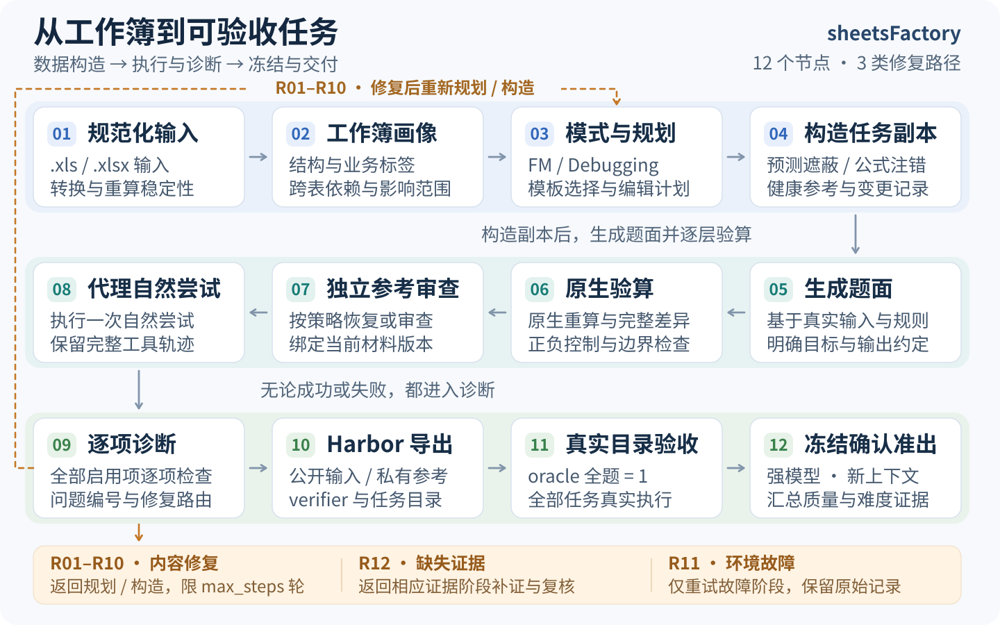

# sheetsFactory

从 `.xls` / `.xlsx` 工作簿构造 **Financial Modeling** 和 **Debugging** 任务：自动画像、规划、mask/注错、代理尝试、诊断修复、验收和 Harbor 导出。每次运行启动实时面板，记录节点状态、耗时、token、产量与转化率。

详细抽象、节点实现、检查编号与修复路由见 **[管线设计文档](docs/PIPELINE_DESIGN.md)**。

## 产线流程

[](assets/pipeline-overview.svg)

代理尝试成功或失败都进入诊断。内容修复、补证与基础设施重试分别计数。通用入口默认先完成质量构造；正式难度确认另行冻结执行。

## 环境准备

需要 Linux、Python 3.12、uv、Docker；产题还需要可调用目标模型的原生 Codex CLI。依赖锁定 Harbor 0.25.0。从仓库根目录执行：

```bash
UV_PROJECT_ENVIRONMENT=.venv312 uv sync --frozen --extra test --python 3.12
source .venv312/bin/activate
python scripts/restore_runtime_inputs.py
```

加载交付题集使用的固定 LibreOffice 24.2.7.2 / openpyxl 3.1.5 镜像。以下命令需要 `gh` 已具备本仓库私有 Release 的读取权限：

```bash
mkdir -p outputs/runtime
cd outputs/runtime
gh release download runtime-lo-24.2-iterative-openpyxl315-v1 \
--repo ZhaoyangHan04/sheetsFactory \
--pattern 'sheetsfactory-lo-24.2-iterative-openpyxl315-v1.tar.gz*' \
--pattern runtime_manifest.json
sha256sum --check sheetsfactory-lo-24.2-iterative-openpyxl315-v1.tar.gz.sha256
docker image load --input sheetsfactory-lo-24.2-iterative-openpyxl315-v1.tar.gz
cd ../..
```

镜像标签为 `sheetsfactory-lo:24.2-iterative-openpyxl315-v1`，镜像 ID 为 `sha256:b3a295b1ea8e88931893a96d8e5f1af97a998333a02189103bef5d223d13e043`。

产题和模型解题通过环境变量读取服务配置；oracle/nop 不需要模型密钥：

```bash
export SHEETS_FACTORY_API_KEY='your-key'
export SHEETS_FACTORY_BASE_URL='https://your-service/v1'
command -v codex
```

也可将密钥保存在被忽略的 `.secrets/api_key`。旧说明保留在本地；少量被程序读取的固定文本由恢复脚本按摘要还原，不覆盖已有不同内容。

## 配置与启动产题

先复制基准配置，保留其余默认字段：

```bash
mkdir -p outputs
cp config/pipelines/quality40.yaml outputs/pipeline.local.yaml
```

在 `outputs/pipeline.local.yaml` 中修改下列字段，`agents.binary` 使用上面查到的实际 Codex 可执行路径：

```yaml
run:
  targets: {financial_modeling: 10, debugging: 10}
  max_parallel_sources: 4
  max_steps: 3
engine:
  image: sheetsfactory-lo:24.2-iterative-openpyxl315-v1
agents:
  binary: /absolute/path/to/codex
  container_image: sheetsfactory-lo:24.2-iterative-openpyxl315-v1
  model: gpt-6-sol
  reasoning_effort: high
diagnosis:
  selection: {include: all, exclude: []}
  execution: {llm_batching: grouped}
  difficulty_deferred: true
```

```bash
./scripts/run.sh --config outputs/pipeline.local.yaml --seeds /path/to/workbooks --port 0
```

`--seeds` 接受文件或递归目录。追加 `--count 40` 会覆盖配额为20+20；自定义两类数量时使用 `run.targets`。`max_steps` 限制内容修复轮数，补证和环境重试另有预算。配置、模板与提示词的职责如下：

| 位置 | 配置内容 |
| --- | --- |
| `config/llm.yaml`、`config/agents.yaml` | CLI默认值、各角色模型与提示词映射 |
| `config/pipelines/*.yaml` | 题量、来源、并发、预算、构造模式和诊断策略 |
| `config/checkers.yaml`、`config/routes.yaml` | Q01–Q12检查插件、问题编号及修复路由 |
| `config/nodes.yaml`、`src/sheets_factory/pipelines/templates/` | 节点注册与两类任务阶段模板 |
| `prompts/` | 规划、题面、轨迹诊断和修复提示词 |

管线会打印面板地址，`--port 0` 分配可用端口；`--headless` 仅关闭自动打开浏览器。运行记录在 `outputs/runs/<run-id>/`，新题导出到其中的 `SpreadsheetEval/`。默认结束后保留面板，`--exit-on-finish` 可在结束时关闭。

```bash
./scripts/run.sh --resume outputs/runs/your-run-id
python scripts/serve_dashboard.py --run outputs/runs/your-run-id --port 0 --open-browser
```

输入只保证文件格式；不满足可解释性、稳定性或质量要求的工作簿会被拒绝，因此目标数量不等于保证产量。通用 `quality40` 默认延后难度，不会一键重建本仓库专用20题的全部历史来源与审计。

## 跑题与验收

交付目录位于仓库根目录 **[SpreadsheetEval/](SpreadsheetEval)**。任务书要求的完整目录命令为：

```bash
harbor run -p SpreadsheetEval -a oracle
harbor run -p SpreadsheetEval -a nop
```

验证新产数据时，将 `-p` 换成 `outputs/runs/<run-id>/SpreadsheetEval`。Harbor结果保存在 `jobs/`。

直接使用本地原生 Codex 对当前题集解题、获取原始评分：

```bash
harbor run -p SpreadsheetEval \
-a sheets_factory.evaluation.frontier:LocalCodex \
--ak native_binary="$(command -v codex)" \
-m gpt-6.1-sol --effort xhigh --sm \
--base-url "$SHEETS_FACTORY_BASE_URL" \
--api-key-name SHEETS_FACTORY_API_KEY --api-format openai_responses \
--n-attempts 1 --max-retries 0 --n-concurrent 4
```

该命令运行真实模型并产生原始Harbor评分；完整准出还需独立工具计时、冻结身份及实际资源审计，详见设计文档。

## 当前数据与测试结果

| 任务来源 | FM | Debugging | 每题结构 |
| --- | ---: | ---: | --- |
| 经营报表 | 5 | 5 | 211张sheet，200家企业及分部/集团报表 |
| 双投资组合 | 5 | 5 | 741张sheet，两个各360项目的投资组合及集团报告 |
| 合计 | 10 | 10 | 20道Harbor任务 |

新增FM每题实际变化3,044,678格；新增Debugging约897,200格，包含利息口径、税损到期、情景收入等公式错误及待修复项目选择。五份组合健康工作簿共享六个本地来源；同源变体不按独立数据集计数。

| 验收项 | 配置 / 实测结果 |
| --- | --- |
| 最强模型 | 原生Codex CLI，`gpt-6.1-sol / xhigh`，每题一次确认 |
| 运行资源 | 固定上述镜像；agent/verifier各2 CPU、32 GiB；计算最多2线程 |
| 精确评分 | 重算后两位小数类型值与完整修改集合；少改、多改、错值均为0 |
| 目录控制 | oracle **20/20 reward=1**；nop **20/20 reward=0** |
| 原始模型通过率 | FM **0/10**；Debugging **1/10**；合计 **1/20＝5%** |
| 证据范围 | 保留10题历史成绩＋10题新上下文确认；没有按确认结果换题 |
| 工具预算 | 累计执行严格小于1800秒，排除模型响应，并行执行求和 |
| 预算后通过率 | **[0%,5%]**；新10题计时2条完整、8条UNKNOWN，未知不作为判错依据 |

预算限制只能减少原始成功数，即使把唯一原始正确答案按可能成功计算，上界5%仍满足0.2门槛。程序验算、语义审查和真实控制覆盖全部启用检查，候选层Q08为not_applicable，正式难度单独确认。

本次修订18份候选新增准出10份，转化率 **55.56%**，另保留历史10份。含辅助验收的38次CLI请求已知消耗下界 **76,897,970 tokens**，另6次用量未知；实际账单未知。完整[发布](reports/ringfenced_business_revision_release.json)、[控制](reports/ringfenced_business_revision_controls.json)、[消耗](reports/ringfenced_business_revision_consumption.json)及[文件清单](SpreadsheetEval/dataset_manifest.json)以机器可读JSON保存。

## 任务书验收 checklist

按任务书第1.1–1.4、2.1–2.2节及交付物清单逐项核对，以下状态对应当前根目录的20题。任务书要求两类各至少5题；10+10、nop及工具预算是本项目的补充验收。

- [x] **题型与数量**：Financial Modeling、Debugging各10题，均超过各5题的最低要求。
- [x] **业务与规模**：多sheet、跨表协作和大范围修改，覆盖经营报表与资本配置场景；具体分布见上表。
- [x] **仅程序化评分**：不以图表、可读性、美观或注释质量判分。
- [x] **难度实测**：最强可用配置为原生Codex CLI `gpt-6.1-sol / xhigh`，Overall Pass@1为 **5% ≤ 20%**；分项成绩和证据范围见上表及[发布报告](reports/ringfenced_business_revision_release.json)。
- [x] **计算值评分**：实际LibreOffice重算后比较值，不比较公式字符串。
- [x] **数值与日期**：数值按两位小数比较，日期归一化；实现见[精确比较器](src/sheets_factory/evaluation/streaming_verifier.py)。
- [x] **完整修改集合**：输出相对输入的修改集合须与参考一致，少改、多改、错值均判0，未要求变动的单元格也必须保持一致。
- [x] **二元奖励**：每题reward只取0或1，dataset score为全部题目reward的均值。
- [x] **自动scaling**：参考工作簿、mask/注错、题面、验证与导出均由程序执行，无需逐题人工编辑；抽象及专用构建路径见[设计文档](docs/PIPELINE_DESIGN.md)。
- [x] **原创任务**：交付题由本地业务模型程序构造，未使用官方原题作为交付题。
- [x] **Harbor结构**：[SpreadsheetEval/](SpreadsheetEval)中20题均包含`instruction.md`、`task.toml`、`environment/`、`solution/`、`tests/test.sh`。
- [x] **真实正确参考**：`reference.xlsx`由程序构造，来源验算、独立审查与当前材料绑定，证据索引见[发布报告](reports/ringfenced_business_revision_release.json)。
- [x] **完整目录oracle**：实际执行`harbor run -p SpreadsheetEval -a oracle`，**20/20 reward=1**，无异常、缺失或未知结果；见[控制报告](reports/ringfenced_business_revision_controls.json)。
- [x] **交付内容**：构造代码、题目目录、README、造题解读、模型分数表、Harbor命令及下述失败案例均已提供；[仓库链接](https://github.com/ZhaoyangHan04/sheetsFactory)。

失败案例依据[保留题逐格分析](reports/history/operating_report_factory_business_retained_v1.json)，均来自当前题集：

- **FM F17**：应改与实改集合均为85,638格，但802格值错误，其中800格属于联营损益列报行（`reported_associate_line`），另有同比、环比各1格。覆盖修改范围后，仍需算对每一格业务结果。
- **DBG S19**：应改8,140格，实际改7,340格，遗漏800格联营损益列报行，没有额外改动。修复需要覆盖所有同类业务行及受影响结果。

以上是逐格结果分析，未将字段差异分布视为已经证实的模型推理根因。

补充验收状态：

- [x] **10+10与nop控制**：当前各10题；真实nop **20/20 reward=0**。
- [x] **运行资源**：实际agent/verifier各2 CPU、32 GiB，已记录资源审计。
- [x] **工具预算下的难度上界**：按累计工具执行严格小于1800秒计算，预算后通过率区间为 **[0%,5%]**，上界满足20%门槛；UNKNOWN未被作为判错依据。
- [ ] **逐轨迹工具计时完整**：新确认10题中2条完整、8条UNKNOWN。尚不能声称全部轨迹计时完整或全部满足30分钟限制。
