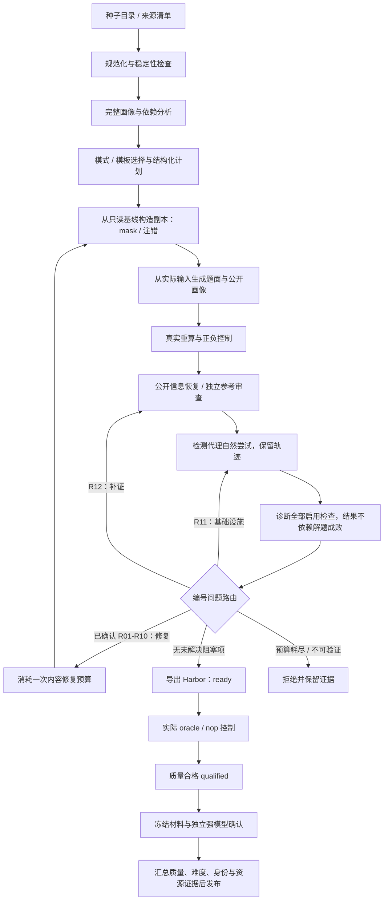

# sheetsFactory 管线设计

本文描述仓库中已经实现的抽象、节点、质量控制和发布路径。安装、启动与当前交付结果见 [README](../README.md)。源码中的专用实验和历史版本仍可用于追溯，但不应把某个实验脚本当作所有输入都适用的通用接口。

## 1. 目标、输入和输出

输入只假设是 `.xls` / `.xlsx` 文件，不假设固定字段、财务模型类型、sheet 名或公式正确性。通用管线先检查可读取性、重算稳定性、业务可解释性与依赖范围，再决定能否构造任务；不能保证任意工作簿都能产出合格题。

支持两种任务模式：

| 模式 | 从健康参考工作簿构造输入 | 用户任务 |
| --- | --- | --- |
| `financial_modeling` | 遮蔽选定公式或完整模型区域，保留可公开推导的业务输入 | 补全财务计算，并恢复关联报表结果 |
| `debugging` | 注入有可观测影响的公式错误；专用路线还可设置待修复的项目选择 | 识别、修复业务逻辑错误，并更新全部受影响结果 |

每个候选有独立 `task_id`，每次实质修复形成新 `revision`。同一原始工作簿产生的模式、变体共享来源身份，不能重复计为不同来源。输出包括公开题面和输入、私有参考及构造证据、逐版本诊断、Harbor 任务目录，以及实际验收摘要。



图中是职责顺序。具体恢复阶段由模板指定；诊断自身的基础设施故障只重试诊断，不重复自然尝试。当前交付专用路线把冻结后的模型确认与根目录控制分别执行，再由发布器汇合证据。

## 2. 目录与配置职责

| 路径 | 职责 |
| --- | --- |
| `config/llm.yaml` | CLI、provider、凭据位置、基础模型、调用并发与容器默认值 |
| `config/agents.yaml` | planner、repair、trace、public/reference reviewer 等角色配置及提示词映射 |
| `config/pipelines/` | 题量、来源、预算、调度、构造和诊断配置 |
| `config/nodes.yaml`、`config/task_adapters/` | 通用节点注册与业务适配节点注册 |
| `config/checkers.yaml`、`config/routes.yaml` | 检查插件及编号问题到修复路径的确定性映射 |
| `config/runtime_profiles/` | 专用来源、求解器、验证器的镜像、资源、时间和覆盖限制 |
| `prompts/` | 规划、恢复、轨迹、诊断和修复提示词；节点可通过映射覆盖 |
| `data/` | 本地输入种子、来源清单及来源准备结果 |
| `src/sheets_factory/core/` | 上下文、节点、管线模板和审计抽象 |
| `src/sheets_factory/nodes/` | 通用构造与质量节点 |
| `src/sheets_factory/workbook/` | 解析、画像、LibreOffice 引擎、比较器和财务模型实现 |
| `src/sheets_factory/task_adapters/`、`pipelines/` | 业务适配节点、控制器及阶段模板 |
| `src/sheets_factory/evaluation/` | Harbor 导出、原生模型评测、流式评分和资源观测 |
| `scripts/` | 启动、数据准备、专用构建、评测、只读报告和发布入口 |
| `outputs/` | 本地运行、模型原始记录、私有证据与面板数据库，不随 Git 发布 |
| `SpreadsheetEval/` | 当前可直接运行的交付任务及冻结清单 |
| `reports/` | 公开发布、控制和消耗摘要；详细本地证据的索引 |

GitHub 只保留 README 和本设计文档作为项目说明；旧说明在本地保留。少量历史代码把政策或合同文本作为运行输入，并绑定其原始字节摘要。这些真实依赖以 `.txt` 和 manifest 存在 `runtime/assets/document_inputs/`，由 `scripts/restore_runtime_inputs.py` 恢复缺失的旧路径；已有文件若不匹配则拒绝覆盖。`run.sh` 在环境同步后调用恢复，环境准备也可显式执行一次。兼容资产是程序输入，不作为额外说明文档入口，既有冻结代码和交付任务不因此改变。

新运行由 [cli.py](../src/sheets_factory/cli.py) 合并基础 LLM 配置、角色配置和指定管线配置，写出 `resolved_config.yaml`。`--count` 覆盖总题量并分配两种模式；分别指定数量时应编辑 `run.targets`。`--seeds` 覆盖来源清单，接受目录或单个文件；不会自动下载所有外部来源。

主要配置键及边界：

| 配置 | 含义 |
| --- | --- |
| `run.targets` | 两种模式各自需要的数量 |
| `run.max_sources` | 最多尝试的来源数量 |
| `run.max_candidates_per_seed` | 每个来源的变体尝试上限，不等于保证产题数 |
| `run.max_parallel_sources` | 来源调度并发；与模型调用并发分别控制 |
| `run.scheduler` | `rolling` 或 `source_batches` |
| `run.max_steps` | 内容修复次数上限，初始版本为 0 |
| `run.max_evidence_rounds_per_revision` | 同版本补证轮数上限 |
| `run.infrastructure_retries_per_stage` | 同版本基础设施重试上限 |
| `agents.max_parallel_calls` | 模型调用并发上限 |
| `construction.authoring_backend` | `llm` 或已实现的 project / portfolio / composite 模板 |
| `construction.planning_scope` | `both_modes` 或 `per_mode` |
| `diagnosis.selection`、`diagnosis.execution` | 检查选择、批处理方式和证据传输策略 |
| `diagnosis.reference_evidence_policy` | 独立公开恢复或独立参考审查 |
| `harbor.execute_controls` | 是否执行真实 Harbor 控制；关闭时不授予实际控制通过结论 |

通用默认配置 [quality40.yaml](../config/pipelines/quality40.yaml) 是质量构造配置，目标 20+20，并将正式难度确认延后。它不会自动重建当前交付的专用 20 题，也不能单凭 `qualified` 状态声称满足正式难度门槛。难度迭代入口与当前专用发布路径见第 9、10 节。

## 3. 核心抽象与生命周期

### 3.1 TaskContext：任务与版本的状态载体

[TaskContext](../src/sheets_factory/core/node.py) 是 dataclass，字段包括 `run_id`、`task_id`、`mode`、`source`、任务目录、配置、审计、LLM、引擎、`revision` 和 `data`。`revision_dir` 指向 `revisions/NNN/`，`save(name, data, private=True)` 将 JSON 写入本版本的公开或私有目录。

实现中没有单独的 `RunContext` 或统一 `Artifact` 类。运行服务由 CLI 创建、Factory 持有，并注入每个 TaskContext；产物通过 `Path`、字典和 `path + sha256` 引用传递。通用接口是轻量上下文，专用来源和发布流程再对引用图、完整字节和配方身份执行严格验证。

典型本地产物布局如下；不同适配器可以增加文件，不应假设每个历史运行都具备同名字段：

```text
outputs/runs/<run_id>/
  resolved_config.yaml
  run.sqlite / events.jsonl / summary.json / dashboard.json
  sources/<source_hash>/baseline.xlsx / profile.json / stability.json
  tasks/<task_id>/
    lineage.json
    revisions/000/
      public/input.xlsx / instruction.md
      private/goal.xlsx / plan.json / expected_delta.json
      private/local_controls.json / trajectory.json / diagnosis.json
      private/independent_recovery.json 或 reference_review.json
    revisions/001/...
  SpreadsheetEval/<task_id>/...
  llm_calls/private/<call_id>/...
```

### 3.2 BaseNode：统一观测，子类实现执行

[BaseNode.run](../src/sheets_factory/core/node.py) 负责记录 `node.started`、更新任务和节点 running 状态、执行 `execute(context)`，将返回字典合并到 `context.data`，最后记录真实单调时钟耗时、异常和完成状态。子类只实现 `execute`，不自行推进内容版本或重置预算。

`TaskRejected` 表示候选或阶段不满足要求；`CooperativeCancelled` 是独立的停止控制流，避免被普通异常处理吞掉。BaseNode 统一处理生命周期观测；具体输入、类型、哈希和业务前置条件仍由各节点验证，不能把基类理解为自动覆盖所有业务校验。

### 3.3 BasePipeline 与 FactoryPipeline

[BasePipeline](../src/sheets_factory/core/pipeline.py) 从节点注册表加载 `module:Class`，验证目标类继承 BaseNode，再读取模式模板。模板包含 `preparation`、`revision`、`evidence`、`diagnosis_retry`、`infrastructure_retry`、`repair` 和 `export`。

启动时检查模式一致、必需阶段、空或重复节点，以及 `construct → instruction → precheck → independent_recovery → trajectory → diagnose` 的必需顺序。`diagnosis_retry` 只能包含 `diagnose`，防止诊断服务重试偷偷重跑求解代理。

[FactoryPipeline](../src/sheets_factory/pipelines/factory.py) 管理来源、配额、在途预留、目标区域占用、修复和控制验收。状态主要为 `running → ready → qualified`，或 `rejected / cancelled`。`ready` 仅表示当前质量诊断通过并已导出；真实 Harbor 控制仍待完成。

扩展业务时可替换注册表中的节点，或者继承 FactoryPipeline 调整来源准入和阶段前置条件。例如 EntityGroup 的计划、画像、构造、诊断和导出节点使用业务适配类；不能只替换计划而绕开对应来源证明、引擎与评分限制。

## 4. 通用节点实现

通用注册表见 [nodes.yaml](../config/nodes.yaml)，实现位于 [construction.py](../src/sheets_factory/nodes/construction.py) 和 [quality.py](../src/sheets_factory/nodes/quality.py)。

| 节点 / 实现 | 输入与具体行为 | 核心产物 / 拒绝条件 |
| --- | --- | --- |
| `normalize` / NormalizeNode | 按源文件摘要建立只读来源缓存；转换为 xlsx，并实际重复重算 | baseline、stability、engine report；重算不稳定则拒绝 |
| `profile` / ProfileNode | 完整遍历配置支持范围，识别 sheet、公式、缓存值、标签、错误、依赖和跨表边 | profile；通用默认要求至少 4 个非空 sheet、6 个公式和真实跨表依赖；画像截断不通过 |
| `plan` / PlanNode | 将画像、来源业务证据、构造契约及历史目标区域送给 planner，或调用已验证模型模板 | 模式计划、公开规则、目标编辑和参考依据；可明确拒绝不适合的来源 |
| `construct` / ConstructNode | 从基线创建 goal；应用公开场景输入并重算，再执行批准 edits 构造 input | input、goal、完整 D、编辑验证、原生风险和根因影响报告 |
| `instruction` / InstructionNode | 根据计划及实际输入形成最终题面，加入公开规则、场景、输出路径和必要区域 | instruction、公开画像、input+instruction 版本哈希 |
| `precheck` / ControlsNode | 检查正确参考、未修改输入、等价公式、漏改一根因和额外改动 | 预期 reward 为 1/0/1/0/0；任一不匹配则拒绝 |
| `independent_recovery` / RecoveryNode | 根据 reference policy 执行公开恢复，或记录参考审查政策下的恢复跳过与版本绑定 | 当前版本恢复证明，或不声称公开恢复的政策记录 |
| `trajectory` / TrajectoryNode | 仅给检测代理公开 input 和题面，执行一次自然尝试 | 原始事件、回复、耗时、错误；成败均进入诊断 |
| `diagnose` / DiagnoseNode | 执行检查计划，分离公开/参考诊断，汇总程序证据和轨迹 | assessments、issues、routes、coverage、releasable |
| `repair` / RepairNode | 将已确认的编号问题和允许动作交给 repair planner | 必须解释全部分配 issue；返回 next_plan；无变化终止 |
| `export` / ExportNode | 从当前公开和私有版本导出真实 Harbor 结构 | export manifest、lineage；之后等待实际控制 |

### 4.1 结构化规划与可执行修改

通用 LLM 返回结构化计划和 `edits`，其中每项明确 sheet、cell、原公式和新值。FM 的新值必须为空，Debugging 必须是不同的 Excel 公式。程序检查原公式完全匹配、坐标存在且不重复，再执行副本修改；不是让任意 LLM 代码直接覆盖原始文件。

FM 也可使用 `mask_ranges`，由程序只选择已有公式并从不可变基线编译 before assertions。通用默认编辑上限为 80，模式最小数分别为 6 和 2，可在支持边界内配置。专用百万级来源使用相应适配器和流式工具，不能直接套用通用画像和编辑上限。

`scenario_inputs` 只允许对匹配原值的数值或空白输入设定有限数值，不能覆盖公式、文字标签或日期；场景必须在题面公开，并先形成重新计算的健康 goal。原始工作簿存在不能证明其公式正确；来源证据不足时拒绝，不补造历史事实。

### 4.2 可观测影响和完整依赖范围

把规范化、重算后的输入记为 I，参考记为 G。程序计算完整差异集合 `D = {c | I[c] != G[c]}`，包括直接修改的单元格及所有实际变化的下游结果。不能只检查注错根单元格，也不能用题面一句“忽略其他区域”排除已经受影响的单元格。

通用构造要求 D 非空、FM 每个遮蔽目标有规范化数值影响、目标依赖闭包内存在真实跨表公式边，并检查原生计算错误、支持范围、易变函数和危险区域。Debugging 有 strict、separated / batched separated、shadow roots 等影响验证方式；使用哪一种由构造契约指定，并保留相应证明。

## 5. 可插拔诊断与编号路由

### 5.1 检查选择和调用次数

[DiagnosisRunner](../src/sheets_factory/checkers/runner.py) 读取 [checkers.yaml](../config/checkers.yaml)，默认 `include: all`、`exclude: []`，执行 Q01—Q12。重复 ID、未知 ID、循环依赖或缺失依赖在启动/解析阶段报错。禁用项记为 `skipped`，不当作通过，也不能自动消除已经存在的问题。

```yaml
diagnosis:
  selection:
    include: all
    exclude: []
  execution:
    llm_batching: grouped
  reference_evidence_policy: independent_public_recovery
  difficulty_deferred: false
```

检查不是固定“一次 LLM 调用”。Q05、Q10、Q11 和 Q12 是程序检查；其他检查使用 LLM/hybrid 证据。默认 grouped 通常把公开语义检查分为一批、私有参考检查分为一批，实际调用数取决于选择、模型/工具覆盖和可复用结果。`per_check` 可逐项调用；`all_in_one` 只合并兼容检查，公开与私有可见性、模型和工具身份仍是硬边界。

检查输出包含 `clear / flagged / unknown / not_applicable` 及执行状态；每个 assigned ID 必须恰好返回一次。Q12 最后检查启用项的完成和关键证据，不递归检查自身。即使关闭 Q12，协议完整性以及独立参考证据等必需门禁仍存在。

### 5.2 问题编号到修复路线

| 编号 | 检查内容 | 确认后的路线与修复范围 |
| --- | --- | --- |
| Q01 | 必要假设是否公开且足以推导 | R01：补充有依据的公开假设或更换目标 |
| Q02 | 业务规则和输出契约是否有实质歧义 | R02：澄清规则，并按影响重建 goal / verifier |
| Q03 | 题面与实际输入、目标区域是否一致 | R03：重写题面；专用 instruction-only 分支禁止修改业务或工作簿计划 |
| Q04 | 参考答案是否有独立正确性依据 | R04：独立验算、重建基线/参考，不能验证则淘汰 |
| Q05 | 验证器能否识别正确、等价、漏改与多改 | R05：修复验证器，重跑正负控制和相关结果 |
| Q06 | mask / bug 是否越界、残留、无影响或相互抵消 | R06：调整修改方案，重新构造输入并实测影响 |
| Q07 | 是否公开了直接答案或私有构造信息 | R07：移除非必要答案副本，保留必需业务输入，再做公开恢复 |
| Q08 | 是否存在已证实捷径或违反预先声明复杂性约束 | R08：重规划关联模块、遮蔽或有效根因组合；正式难度另外确认 |
| Q09 | 原生错误、基线污染或可信范围不足 | R09：有证据地修复来源、限制范围或换源 |
| Q10 | 引擎、转换、重算或稳定性兼容问题 | R10：修复环境/规范化，或选择受支持依赖范围 |
| Q11 | 服务、挂载、进程、工具等基础设施故障 | R11：同版本重试基础设施，不当作题目内容错误 |
| Q12 | 证据缺失、检查未覆盖或结论仍未知 | R12：同版本补证，不凭怀疑直接改题 |

问题实例另有 `issue_id`、`certainty`、归因、证据、当前版本哈希和依赖关系。固定映射见 [routes.yaml](../config/routes.yaml)，实现见 [router.py](../src/sheets_factory/checkers/router.py)。未确认问题统一先补证；明确属于环境失败的实例转 R11；依赖先于优先级执行。路由还列出允许动作、失效产物和必需复核项。

### 5.3 自然尝试不是质量判定开关

检测代理尝试无论成功、失败、超时或部分执行，都交给诊断。Runner 清除 reward、solved、pass@1 等观察字段，防止“模型没做对”直接变成题目缺陷。诊断依据题面、输入、真实事件、程序控制和参考证据逐项判断；代理自身的操作错误应归因到 agent behavior。

候选层 Q08 审查具体捷径和硬约束。没有适用局部 probe 时可有依据地标 `not_applicable`，明确后续正式 cohort gate 待执行；这不授予最终难度资格。单次成功、完成速度或未达到计划偏好本身不能证明题目过易。

## 6. 修复预算、版本失效和恢复策略

Factory 的决策优先级为基础设施重试、已确认内容修复、补证，最后才是导出。三类预算独立：一次原子内容修改消耗 `max_steps`，补证和基础设施重试不消耗该次数，也不能重置它。内容版本递增后，本版本补证和基础设施计数重新开始；超限以明确原因拒绝。

任何内容修复都从只读基线重新构造，随后执行该版本的完整阶段链。不能直接在失败代理输出上追加补丁，再把它当作健康参考。修复提案必须覆盖全部 assigned issue；Q03-only 分支仅允许改 `public_instruction`；完全不变的提案立即终止空转。

公开输入或题面变化会生成新版本哈希，旧恢复、轨迹、诊断和 Harbor 控制不得冒用。检查结果缓存以公共版本、检查计划、证据 payload 和 reviewer 上下文指纹绑定；未知结论和未确认问题不会永久缓存成可放行答案。

`--resume` 是终态运行的受审计续跑，不是猜测恢复半次模型会话。ProducerLease 防止同一运行双写；续跑保留既有候选、成绩和预算，可追加哈希验证过的来源清单。已有 ready / qualified / rejected 等终态任务不会被普通续跑悄悄重试；指定终态修题须使用显式任务与外部问题证据入口。

```bash
./scripts/run.sh --resume 'outputs/runs/<run_id>' \
  --extra-manifest data/manifests/additional_sources.json
```

协作停止会停止派发新来源、模式、节点和模型请求，等待在途调用留下记录后结束；模型超时与中断的已知事件和用量均保留。`rolling` 调度按剩余配额继续补充候选，`source_batches` 按来源批次推进；两种方式都使用在途预留，避免并发重复占满同一配额。

## 7. 公开/私有隔离与模型服务

[CodexCLI](../src/sheets_factory/llm/codex.py) 提供 `complete`（结构化 JSON）和 `attempt`（自然工具尝试）两个接口。每次调用独立解析角色模型、reasoning 和超时，不并发修改全局默认模型。凭据从环境变量或忽略的本地文件读取，不放入配置、题面、公开审计或 Git。

| 调用身份 | 允许输入 |
| --- | --- |
| planner / repair planner | 来源画像、私有计划、批准的证据和构造契约 |
| trace agent / public recovery | 仅公开 input、instruction 和允许的公开画像 |
| public diagnostician | 公开工作簿、公开题面、清洗后的轨迹和分配检查 |
| reference diagnostician | 上述材料及明确授权的参考、修改集合、财务审计 |
| strongest confirmation | 冻结的公开任务，在新上下文执行，不继承开发会话 |

公开求解/诊断工作区不能包含 goal、mask 映射、参考代码或私有原路径；公开代理由容器隔离。私有参考审查通过独立工作区显式提供证据，不能把其有权看参考的身份混同为公开可解性证明。

两种参考政策明确区分：`independent_public_recovery` 要求公开恢复程序在新容器重放并与参考匹配；`reference_review` 要求全部 12 检查启用，并对当前 input、instruction、goal 的哈希提供有业务依据的独立财务验证。后者不声称已有精确公开求解 witness。

当前新题的语义审查使用有边界的证据包：完整公开业务政策、标明范围的表格样例，以及私有角色才可见的完整程序审计引用。逐格完整性由独立程序证据负责；样例审查不冒充对数百万单元格的人工/LLM 穷举验证。

## 8. 精确评分与 Harbor 验收

评分器先用固定 LibreOffice 环境真实重算，再比较 I、G 和代理输出 O。数字用 Decimal `ROUND_HALF_UP` 归一到两位小数，布尔、文字、错误、日期等保持类型。`True` 与数值 `1` 不等价；不比较公式文本是否与参考完全一致，等价计算方式可以通过。

```text
D_expected = {c : normalize(I[c]) != normalize(G[c])}
D_actual   = {c : normalize(I[c]) != normalize(O[c])}
reward = 1 当且仅当：
  sheet 名和顺序一致，且 D_expected == D_actual，
  且 D_expected 内所有 O 值与 G 值完全相同。
```

少改、多改或应改值错误均得 0。独立错因分析只解释结果，不重新定义原始评分。通用比较器见 [compare.py](../src/sheets_factory/workbook/compare.py)；百万级专用题使用绑定同一值契约的流式验证器。

Harbor 导出包含 `instruction.md`、`task.toml`、`environment/`、`solution/`、`tests/` 和 `export_manifest.json`。agent 环境仅放公开输入和重算工具；参考保存在 oracle/独立 verifier 侧。每个文件由 manifest 绑定，修改或未登记文件会使对应证明失效。

本地 1/0/1/0/0 控制检查比较语义，真实 Harbor oracle/nop 进一步检查镜像、挂载、脚本、路径和评分是否确实可执行。oracle 复制参考输出后应得 1；nop 未作修复应得 0。缺少某一任务、角色、结果文件或出现异常，都不能替换成合成 reward。

当前根目录执行方式是：

```bash
harbor run -p SpreadsheetEval -a oracle
harbor run -p SpreadsheetEval -a nop
```

完整控制发布还验证实际 agent/verifier 的镜像和 CPU、内存、PID 限制，并确认所属容器清理。资源声明本身不是实际观测；混合题集由 [mixed_business_resources.py](../src/sheets_factory/evaluation/mixed_business_resources.py) 分派对应资源配置，未知 profile 拒绝。

## 9. 正式难度迭代与当前交付的统计

通用 [DifficultyPipeline](../src/sheets_factory/pipelines/difficulty.py) 支持质量构造、开发评测、反馈加难、冻结及独立确认；入口为 `scripts/run_difficulty.sh`，以 `--seed-manifest` 指定来源。轮数、token 和墙钟上限在完整阶段之间检查，不承诺把已经运行中的请求即时截停到精确 token 数。

开发结果用于选择业务模块和加难方向；正式确认必须绑定已冻结的材料、提示词、运行配置和新上下文。同一已确认 checksum 或相同语义材料不能通过简单换名反复确认挑成绩。增加规模、跨表依赖、根因组合等必须作用于可解释业务任务，并重新通过输入、参考和实际控制验收。

当前 strongest 配置为原生 Codex CLI `gpt-6.1-sol / xhigh`，每题一次正式尝试。累计工具执行要求严格 `<1800s`，排除模型响应时间，并行工具分别累加；较长的保护墙钟用于防止进程无限运行，不能替代工具时钟证据。

当前 20 题由保留的 5 FM+5 Debugging 和新确认的 5+5 构成，不声称本轮重跑了全部 20 题。原始成绩合计 1/20 成功，FM 0/10、Debugging 1/10。正式发布摘要见 [发布报告](../reports/ringfenced_business_revision_release.json)。

新确认 10 条中，2 条有完整工具计时，8 条计时 UNKNOWN。发布报告保留未知并使用对模型最有利的上界，不把未知本身计为失败。设 `r∈{0,1}` 为有效精确答案评分、`b=1[T_tool<1800]`，则有效成功为 `r×b`：

| 已知证据 | 有效成功范围 |
| --- | --- |
| r=0，工具计时已知或未知 | [0,0] |
| r=1，预算通过 | [1,1] |
| r=1，已证实预算不通过 | [0,0] |
| r=1，预算未知 | [0,1] |

因此当前 20 题预算调整后通过率范围是 [0%,5%]，上界低于 0.2。该结论不表示全部计时完整或每个正确答案已证实满足预算。验证器、材料身份或实际资源证据不完整时仍 HOLD；这一数学上界不能替代这些必需验收证据。

## 10. 当前专用来源和发布路径

通用种子处理面向未知布局；当前交付的高规模业务题另有专用来源构造和审核。两条路径共享隔离、版本、诊断、实际控制与审计原则，但不应宣称一个通用启动命令足以复刻专用来源的全套历史证据。

| 当前组成 | 结构与主要难点 | 实现入口 |
| --- | --- | --- |
| 经营报表 5+5 | 每题 211 sheets、200 家企业，关联经营、分部与集团报表 | `workbook/operating_reports_200/` 与对应 factory/quality 脚本 |
| 资本配置 5+5 | 每题 741 sheets、两个各 360 项目的组合；财务修复、约束选择与集团报告联动 | ringfenced source/task/confirmation 专用脚本 |

新来源将六份有独立财务与优化证据的本地模型组合为五份健康工作簿。组合时检查命名和公式变换、原始数据、两套财务实现、全部约束及最佳/次佳证书；再执行真实重算和数值稳定性比较。五份组合不是五个互不相关的公开数据集。

新 FM 遮蔽完整模型和选择区域，实际 D 每题 3,044,678；新 Debugging 注入 172,800 处公式缺陷及 720 个暂定选择，D 约 897,200。缺陷涵盖债务利息口径、税损到期边界和情景冲击的收入反馈，影响后续现金流和 LP/GP 估值；所有项目约束需同时满足。

主要职责入口如下，运行前应读取其命令帮助和所需证据引用；其中部分脚本明确依赖本地冻结审计，不是从 Git checkout 自动下载证据的自包含任务：

1. 来源构造：`build_cached_ringfenced_pair_source_revision2.py`，复用已验证 donor 的完整配方证据，构建新命名空间并执行真实来源审核。
2. 任务构造：`build_cached_ringfenced_pair_task_batch_revision2.py`，分别真实重算 FM/Debugging 输入，核对完整修改集合和内容保护。
3. 质量诊断：`run_ringfenced_bounded_quality_review.py`，公开与参考、两种模式分四次完成审查，并与程序证据汇合；先前未完成请求保留。
4. 冻结确认：`run_ringfenced_replacement_confirmation.py`，校验固定五组材料和开发来源，执行十次新上下文原生确认。
5. 根目录控制：`run_mixed_business_root_harbor_controls.py`，在已安装的完整目录执行真实 oracle/nop 并检查资源。
6. 发布：`publish_ringfenced_business_revision.py` 负责 stage/install 和回滚；`finalize_ringfenced_business_revision5.py` 按当前精确评分、计时上界规则汇合既有证据，不新增模型调用。

先 stage 到独立目录并核验 20 题，再安装根目录，保留原目录快照。确认和控制期间不修改冻结 payload；最终 qualification 写入外部发布摘要，不能重写已用于实测的材料来追认成绩。交付题集自身的 oracle/nop 运行不依赖本地构造审计或模型密钥。

## 11. 可视化、时间、token 与产量审计

[AuditStore](../src/sheets_factory/core/audit.py) 以 SQLite WAL 为权威记录，保存 run 状态、tasks、nodes、calls 和递增 events。JSON、JSONL 和面板是可重建投影。节点开始后立即可见 running 记录，结束时更新同一条记录；失败和预检查错误同样进入面板。

CLI 在密钥和引擎预检查前启动本地 DashboardServer，输出实际 URL 并记录 `dashboard.json`。面板用 SSE 实时更新并按事件 ID 续传，资源静态自包含，不依赖外部 CDN。历史面板只读打开数据库，不启动产线或修改结论：

```bash
.venv312/bin/python scripts/serve_dashboard.py \
  --run 'outputs/runs/<run_id>' --port 8765
.venv312/bin/python scripts/report_run.py 'outputs/runs/<run_id>'
```

时间分为端到端经过时间、producer 活跃阶段累计时间、节点累计时间、CLI 调用时间和解题累计工具时间。并发节点累计可大于墙钟；续跑之间停顿计入端到端、但不计入活跃 producer 时间。不能把 CLI 整体耗时或容器存活时间当作排除模型响应后的工具时长。

Token 优先取 CLI/Provider 实际事件。总量为 input+output；cached input 属于 input 子集，reasoning output 属于 output 子集，不重复相加。超时、取消和未返回用量的调用记 UNKNOWN，同时显示已知下界和未知调用数；缺少可靠逐调用账单时，不将估算价格或共享凭据窗口说成精确运行费用。

产量分母分别记录：扫描工作簿、种子池、预处理尝试、实际使用来源、到达构造节点来源、候选、产题来源和已验收题目。候选转化率=已验收题/候选；来源转化率=有产出来源/实际使用来源；每来源产量=题数/实际使用来源。变体和两种模式不重复增加来源数。

当前修订口径为 18 份候选材料（8 原型+10 最终新增），新增准出 10 份，候选转化率 55.56%，另保留历史 10 份。含辅助验收的已知用量下界 76,897,970 tokens，6 次用量未知；此前批次和官方复测研究另列，不能混成项目全部消耗。分项见 [消耗报告](../reports/ringfenced_business_revision_consumption.json)。

## 12. 扩展与验证约束

新增业务节点时继承 BaseNode，登记节点与模式模板，保留阶段顺序、上下文身份和审计；新增检查时登记 ID、版本、可见性、handler、依赖和路由，并为程序 handler 或模型结构化输出提供实际证据。新增资源 profile 应同步更新导出、检查与实际观测，不能只放宽配置数字。

有意义的验证包括：节点/模板契约、检查选择与隔离、编号路由、修复预算和版本绑定、工作簿值比较、来源公式/财务交叉验证、Harbor 导出身份及实际运行资源。小型单元测试验证控制逻辑，真实 LibreOffice/Harbor 测试验证执行环境；两者不能互相替代。

生产评测、来源重算和付费模型调用通过明确的脚本入口执行，并与控制逻辑单测区分。历史失败、原始 reward 和 UNKNOWN 原样保留，补充解释另写新证据，防止修复审计链时顺带改写过去结果。
